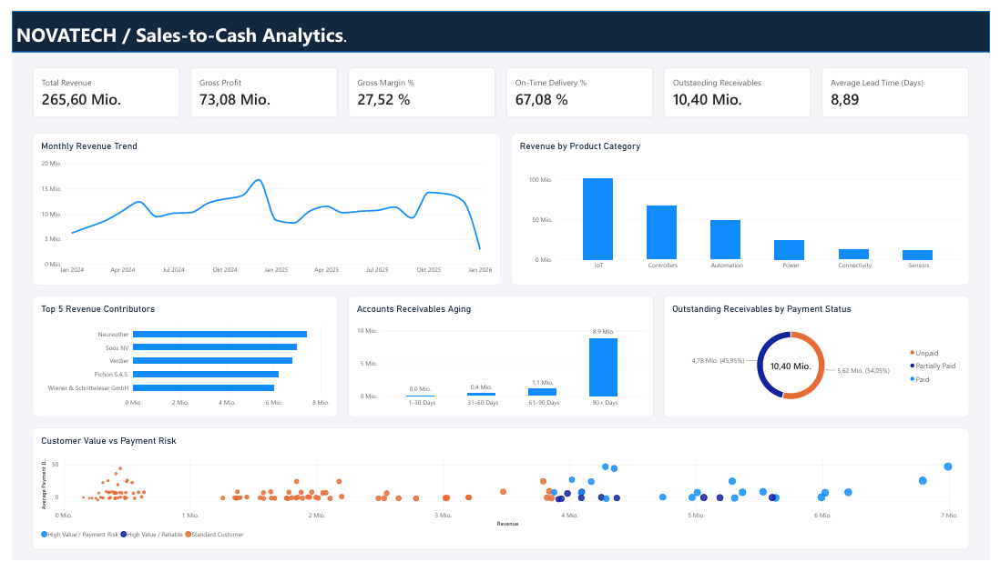
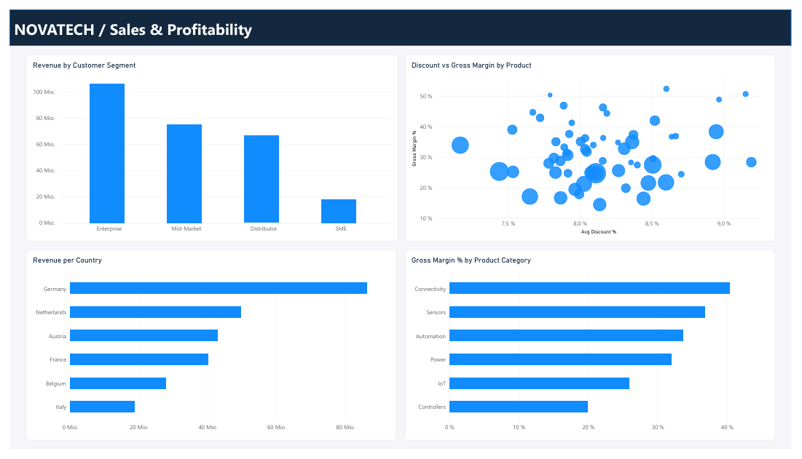
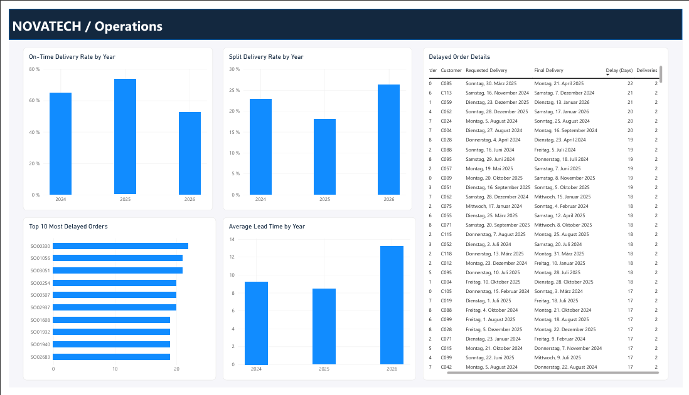
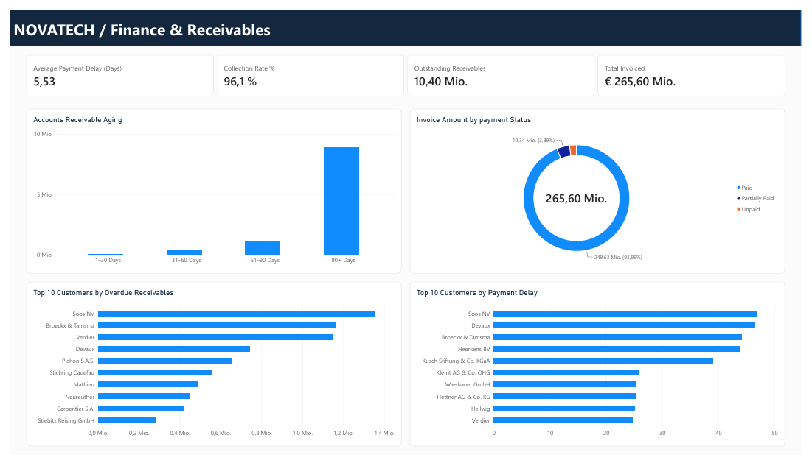

# NovaTech | Sales-to-Cash Analytics

## Project Overview

An end-to-end business analytics project simulating the
Sales-to-Cash process of a fictional B2B technology company.

The project integrates relational databases, Python-based
data processing, SQL analytics and interactive Power BI
dashboards to support data-driven business decisions.

## Technology Stack

- PostgreSQL – Database management
- SQL – Data extraction and analytical views
- Python – Synthetic data generation and analysis
- Pandas & NumPy – Data processing
- Power BI – Business intelligence and visualization
- Excel – Data exploration

## Business Process

Customer Orders → Deliveries → Invoicing → Payments

The project follows an ERP-inspired Sales-to-Cash workflow,
using synthetic transactional data.

## Dataset

| Table | Records |
|---|---:|
| Customers | 120 |
| Products | 60 |
| Sales Orders | 4,000 |
| Sales Order Items | 10,934 |
| Deliveries | 4,688 |
| Delivery Items | 11,412 |
| Invoices | 4,688 |
| Payments | 5,137 |
| Total | 41,039 |

## Dashboard Pages

### 1. Executive Overview
- Revenue and profitability KPIs
- Monthly revenue trends
- Customer value and payment risk
- Accounts receivable monitoring

### 2. Sales & Profitability
- Revenue by market and customer segment
- Product category profitability
- Discount and gross margin analysis

### 3. Operations
- On-time delivery performance
- Split delivery analysis
- Order fulfilment and lead times
- Delayed order monitoring

### 4. Finance & Receivables
- Collection performance
- Accounts receivable aging
- Customer payment behaviour
- Overdue receivables analysis

## Key Business Results

| KPI | Result |
|---|---:|
| Total Revenue | €265.60M |
| Gross Profit | €73.08M |
| Gross Margin | 27.52% |
| On-Time Delivery Rate | 67.08% |
| Average Lead Time | 8.89 days |
| Collection Rate | 96.08% |
| Outstanding Receivables | €10.40M |
| Average Payment Delay | 5.53 days |

## Key Business Insights

- Revenue leadership does not necessarily translate into
  higher profitability across product categories.
- Delivery performance indicates opportunities for
  operational improvement.
- Despite a strong collection rate, approximately €8.9M
  in receivables fall into the 90+ days aging category,
  indicating significant financial risk.

## Data Quality and Validation

Key financial metrics were cross-validated between
PostgreSQL and Power BI. Data transformation issues,
including locale-specific decimal conversion, were
identified and corrected.

## Repository Structure

    data/
        raw/
        processed/
    documentation/
    excel/
    powerbi/
    python/
    sql/
    requirements.txt
    README.md

## Disclaimer

All business data is synthetic and was generated for
educational and portfolio purposes.

This project is inspired by ERP and SAP business processes
but does not use a live SAP system.

## Author

Ali Sabra
M.Sc. Business Economics
Otto von Guericke University Magdeburg

Interests: Business Analytics, Business Intelligence,
Finance, ERP Systems and Digital Transformation.
## Dashboard Previews

### Executive Overview

### Sales & Profitability

### Operations

### Finance & Receivables

[Download the full dashboard report (PDF)](powerbi/NovaTech_Sales_to_Cash.pdf)
